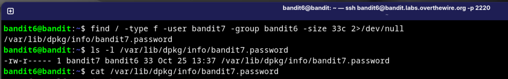

# Bandit 6 → 7 — Búsqueda dirigida con `find`

> 🧑‍💻 Nivel 6 · Plataforma: OverTheWire · Epoch fecha: nov 2026
> 🎯 Objetivo: encontrar un archivo en TODO el sistema con propiedades muy concretas.

## 🧠 Razonamiento

La pista del nivel describe el archivo por tres propiedades — su **dueño**,
su **grupo** y su **tamaño exacto**. `find` es la herramienta diseñada para
cruzar varios filtros a la vez:

| Flag | Qué filtra |
|---|---|
| `-type f` | Solo archivos regulares (no directorios) |
| `-user bandit7` | Propiedad del usuario bandit7 |
| `-group bandit6` | Grupo bandit6 |
| `-size 33c` | Tamaño exacto: 33 **bytes** (`c` = bytes) |

## 💻 Comandos

```bash
# Búsqueda por todo el sistema, silenciando los errores de permisos
find / -type f -user bandit7 -group bandit6 -size 33c 2>/dev/null

# Confirmo el archivo y sus permisos antes de leerlo
ls -l /var/lib/dpkg/info/bandit7.password

# Lectura
cat /var/lib/dpkg/info/bandit7.password
```



## 💡 Lo que me llevo

- **`2>/dev/null`** → cuando buscas sobre `/` entero, tropecientos "Permission
  denied" ensucian la salida; redirigir stderr a `/dev/null` es higiene básica
  de enumeración (lo usaré en cada máquina a partir de ahora).
- **`find` como herramienta de enumeración** → no es "buscar el archivo X",
  es *describir el perfil del objetivo y dejar que el sistema lo huela*.
  Esto conecta directamente con post-explotación: en una máquina real,
  archivos de config con permisos raros o SUIDs anómalos se atasaman igual.
- **Confirmar antes de leer** → `ls -l` antes del `cat`: la lección de que
 Էъь los permisos del archivo te dicen si le va a dejar o no, antes de intentarlo.

## 🏁 Resultado

Contraseña encontrada y almacenada para seguir al nivel 7. *(la password se
omite por norma de la plataforma — la técnica es la que se comparte)*
